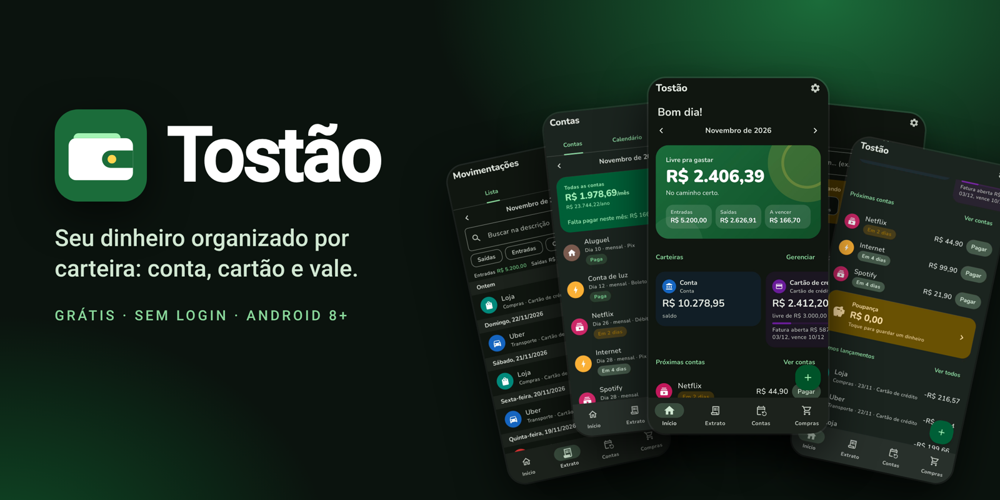
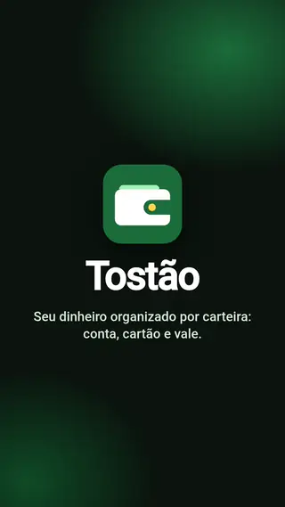
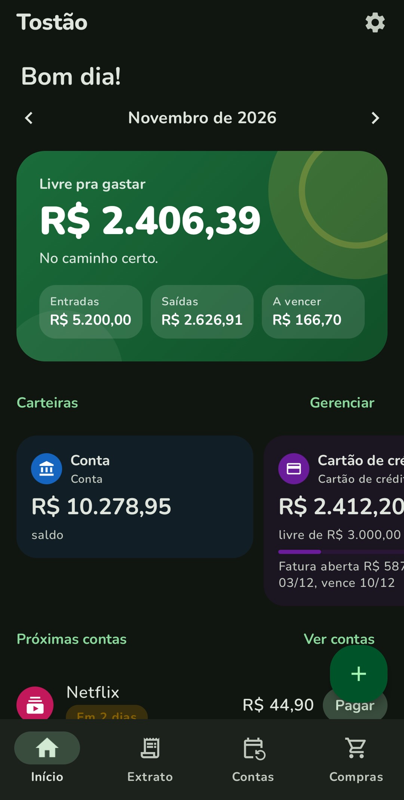
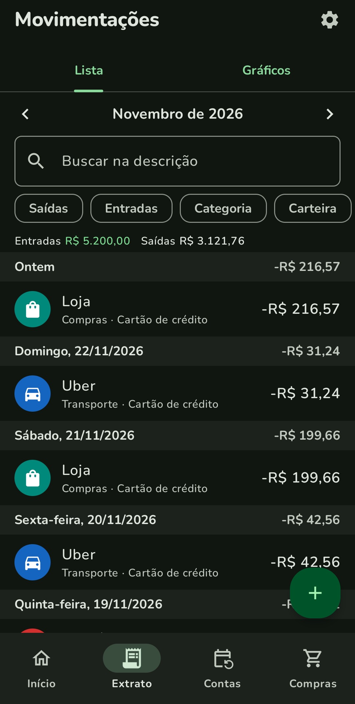
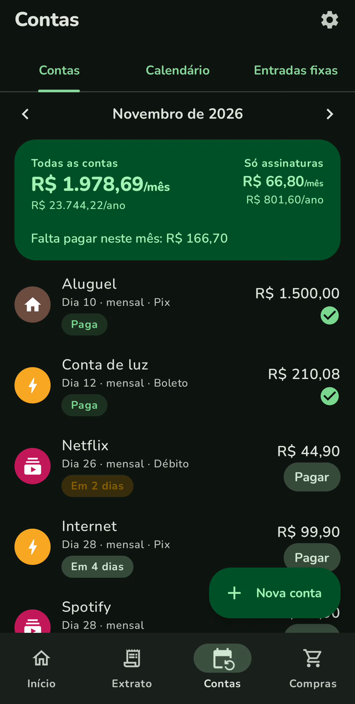
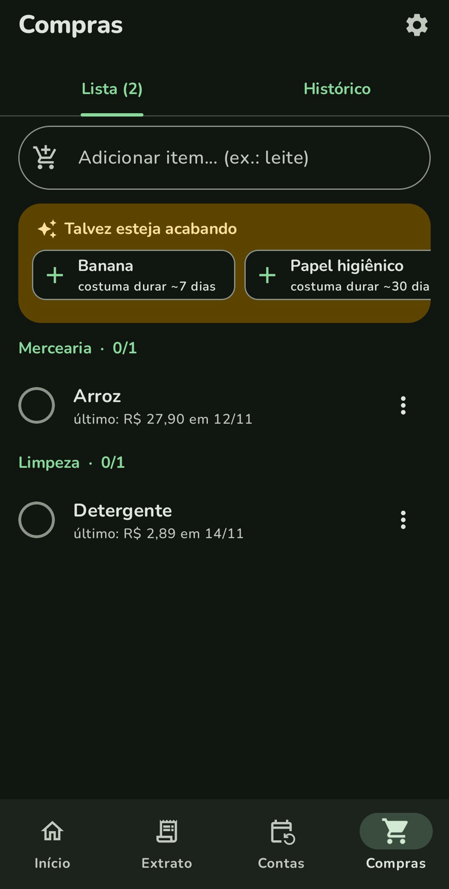
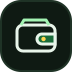
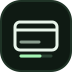

<h1>Tostão</h1>

<b>Seu dinheiro organizado por carteira: conta, cartão e vale.</b> 
Saiba quanto está livre pra gastar no mês, controle o limite do cartão e do vale e nunca esqueça uma conta.

 

   
  <a href="docs/video/tostao.mp4">Assistir em vídeo</a>

  
  
  
  

## Por que o Tostão

Planilha dá trabalho e app de banco só mostra uma conta. O Tostão junta tudo num lugar só: o que entrou, o que saiu, o que ainda vai vencer e quanto sobra. Cada gasto sai de uma carteira, então o cartão de crédito e o vale-refeição têm o próprio limite e o próprio ciclo, do jeito que funcionam na vida real.

## O que ele faz

<table>
<tr>
<td width="80" align="center"></td>
<td><b>Carteiras</b> 
Conta (débito, Pix e boleto), dinheiro, cartão de crédito e vale. Cada uma mostra o saldo ou o quanto ainda está livre. Dá para transferir entre carteiras, por exemplo sacar dinheiro ou pagar a fatura com a conta, sem contar como gasto.</td>
</tr>
<tr>
<td align="center"></td>
<td><b>Cartão de crédito com limite</b> 
Você informa o limite, o dia de fechamento e o de vencimento. O Tostão separa a fatura aberta da fechada, mostra quanto do limite está usado e quando a fatura vence.</td>
</tr>
<tr>
<td align="center"></td>
<td><b>Vale-alimentação e refeição</b> 
Informe o valor que cai por mês e o dia da recarga. A barra mostra quanto já foi usado no período e quanto ainda sobra até a próxima recarga.</td>
</tr>
<tr>
<td align="center"></td>
<td><b>Contas fixas e assinaturas</b> 
Aluguel, luz, internet, streaming, IPVA: mensal, anual ou a cada N meses. O calendário mostra os vencimentos, um aviso chega antes de cada um e um toque marca como paga. As entradas fixas, como o salário, também ficam aqui.</td>
</tr>
<tr>
<td align="center"></td>
<td><b>Quanto está livre pra gastar</b> 
O Início faz a conta por você: entradas do mês menos o que já saiu, o que ainda vai vencer e o que foi para a poupança. Limites por categoria avisam quando chegam a 80% e a 100%, e os gráficos mostram para onde o dinheiro foi.</td>
</tr>
<tr>
<td align="center"></td>
<td><b>Lista de compras que aprende</b> 
A lista separa os itens por seção do mercado e lembra o último preço. Com o tempo, ela percebe quanto cada item costuma durar e sugere o que deve estar acabando.</td>
</tr>
<tr>
<td align="center"></td>
<td><b>Só no seu celular</b> 
Sem conta, sem login e sem servidor. Os dados ficam no aparelho, e dá para bloquear o app com a digital ou a senha do celular.</td>
</tr>
</table>

## Como instalar

O Tostão ainda não tem uma versão publicada. Quando tiver, o arquivo **Tostao.apk** vai ficar na [página de versões](https://github.com/Vicente-PIlonetto/Tost-o/releases).

1. Baixe o **Tostao.apk** no celular.
2. Abra o arquivo. Se o Android pedir, permita **instalar apps desconhecidos** para o navegador ou para o app de arquivos.
3. Na primeira abertura, escolha entre ver o app com **dados de exemplo** ou **começar vazio**. Os exemplos podem ser apagados depois em *Ajustes*.

Para atualizar, instale a versão nova por cima. Seus lançamentos e configurações continuam lá.

## Primeiros passos

- **Cadastre suas carteiras** em *Início > Carteiras > Gerenciar*: a conta, o cartão com limite e dias de fechamento e vencimento, e o vale com valor e dia da recarga.
- **Coloque as contas fixas e o salário** na aba *Contas*, para o Início já descontar o que vai vencer.
- **Escolha o início do mês financeiro** em *Ajustes*, se o seu mês começa no dia do pagamento e não no dia 1.
- **Ligue os avisos** em *Ajustes > Notificações*: lembrete de contas, confirmação de entradas, alerta de limite e lembrete diário.
- **Proteja o app** em *Ajustes > Segurança*.

## Perguntas frequentes

**Preciso criar conta?**
Não. Não há login nem servidor: tudo fica no celular.

**O app lê meu banco?**
Não. Os lançamentos são seus: você registra o gasto em poucos toques pelo botão +.

**Pagar a fatura do cartão conta como gasto duas vezes?**
Não. O gasto conta quando você compra. Pagar a fatura é uma transferência da conta para o cartão, que libera o limite sem entrar como gasto de novo.

**Apaguei um lançamento sem querer. E agora?**
Os excluídos ficam em *Ajustes > Lançamentos excluídos*, de onde podem voltar.

## Privacidade

O Tostão não tem anúncios, contas próprias nem coleta de dados, e não precisa de internet para funcionar. As permissões que ele pede servem só para os avisos no horário certo, inclusive depois de reiniciar o celular.

## Encontrou um problema ou tem uma ideia?

Abra uma [issue](https://github.com/Vicente-PIlonetto/Tost-o/issues/new/choose): há modelos para relatar um erro ou sugerir uma ideia. Quer ajudar com código? Veja o [guia de contribuição](CONTRIBUTING.md).
